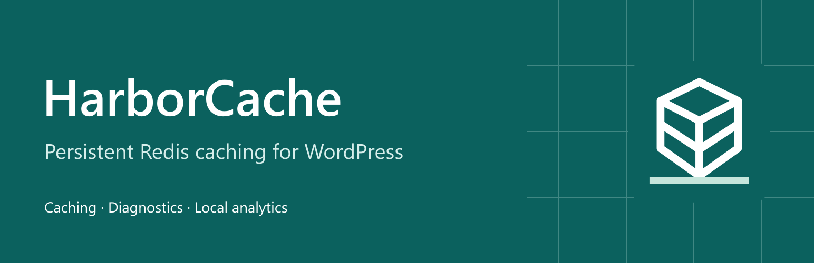
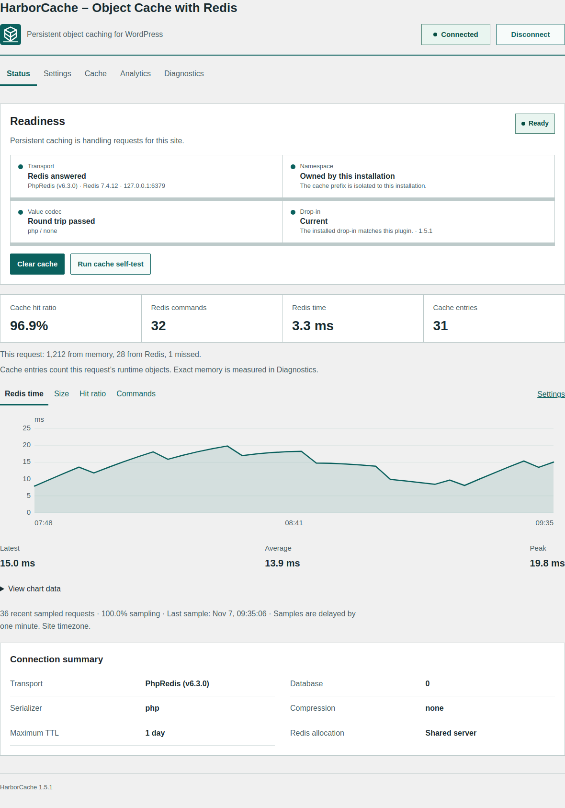
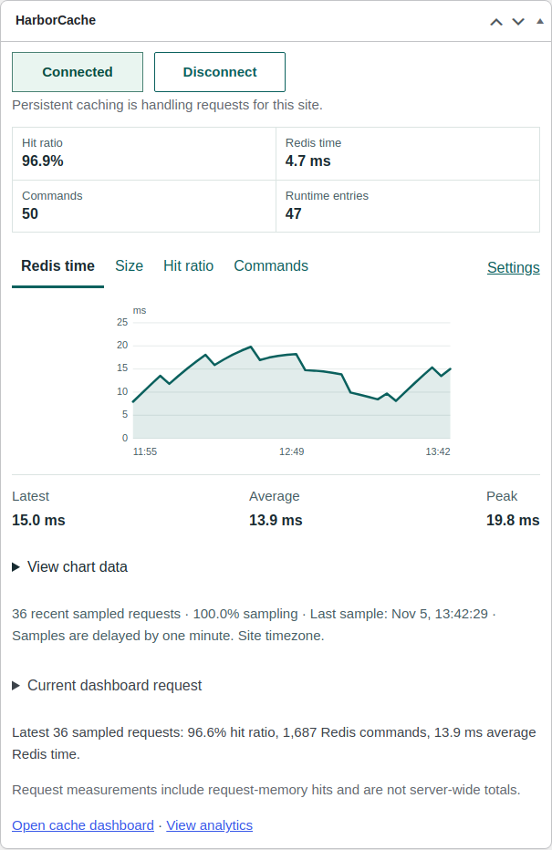

# HarborCache – Object Cache with Redis

Persistent Redis object caching for WordPress, with scoped invalidation, connection management, sampled analytics, diagnostics and a dashboard statistics widget. Current release build: **1.6.1**.

HarborCache brings connection settings, local analytics, scoped invalidation and recovery controls into one administration workflow. It was developed around the day-to-day needs of the author's websites and continues as a separate project with its own interface and development direction.

## Install

Install the [1.6.1 ZIP](dist/harborcache-1.6.1.zip) on an isolated staging site under Plugins → Add New → Upload Plugin. GitHub's source archive includes development documentation and media; use the installable ZIP for WordPress.

Requires WordPress 6.6+, PHP 7.4+ and a separately operated Redis service. Disable the existing object cache manager through its own controls first. Configure a distinct prefix in Settings → HarborCache, save the connection and enable the object cache. HarborCache refuses to overwrite another plugin's drop-in. Verify connection status and Site Health before using it on production.

For upgrades, back up configuration and the owned drop-in. Upload the plugin, then update the HarborCache drop-in if prompted. Prefix ownership conflicts are reported as “Namespace conflict”, preserve the existing owner and use runtime-memory fallback. Reclaim the namespace only after confirming the old site is gone, or configure a distinct prefix for clones. See [configuration](docs/CONFIGURATION.md) and [acceptance gates](docs/ACCEPTANCE.md).

## Features

- Predis, PhpRedis, Relay and Credis connection paths; standalone, replication, Sentinel and cluster configurations.
- Multisite cache group scopes, typed values, bulk operations and bounded TTLs.
- Namespace invalidation without FLUSHDB or FLUSHALL; bounded background reclamation.
- Optional serialization/compression, split autoloaded options and registered-key prefetching.
- Readable administration screens, equal-sized connection controls, responsive charts and accessible chart tables.
- Local sampled request analytics, separate runtime/store counters, WP-CLI, Site Health, Query Monitor and Debug Bar support.
- Protected configuration forms, redacted diagnostic exports, verified drop-in updates and recovery backups.

No license key or account is required. No plugin REST endpoints are included. Optional New Relic/OpenTelemetry adapters require explicit configuration and the host application's integration. See the [feature ledger](docs/FEATURES.md) for supported behavior and validation boundaries.

## Current screenshots

[All screenshots, logos, banners and favicons](media/) include version-free dashboard captures that remain reusable while the layout stays the same. They show a local test installation and demonstration chart history, not production speed measurements. Capture details are in [screenshots.json](media/screenshots.json).

## Validation and deployment gates

The 1.6.1 release hardens the REST API: scoped flush input is explicit, `network_flush` is honored, group flushes cannot escalate to a full install, backend failures return 503, analytics and slow-log responses no longer overclaim, and the API loads only on `rest_api_init`. The 1.6.0 release adds an authenticated REST API under `harborcache/v1` for status, health, analytics, groups, slow log, Relay diagnostics and scoped flushes, plus a bounded group-registry reader. No key format or configuration changes. The 1.5.1 release keeps the WordPress-version integrity check on the key-build path instead of every request-memory hit, so the 1.5.0 features add no measurable per-hit cost; a same-run comparison with 1.4.1 is within 1.3% on every operation. The 1.5.0 release evicts only the invalidated key from request memory when Relay reports a client-side invalidation, reports Relay statistics and memory without the adaptive cache option, adds the WordPress version to the derived-key layout so a core upgrade rotates new keys, and reports `noeviction` and Relay memory pressure in Site Health. The derived-key signature changes once on upgrade; old values remain TTL-bound and expire without a configuration change. The 1.4.1 release restricts prefetch manifests to GET/HEAD page views, raises the manifest to 1,000 keys and 24 hours, skips single-key groups, excludes split `alloptions`, and drops incomplete classes from replay. The 1.4.0 release memoizes one request-local cache id per blog, group and key, so repeated reads skip namespace and context work; it precomputes the routing and instrumentation flags used on every command, skips namespace metadata for non-persistent groups, and removes a redundant group-type lookup. There is no key-format or configuration change. The 1.3.3 release makes the connection check usable on Cluster and Sentinel/replica topologies, reads the upstream topology constants into the effective configuration, allows a saved socket connection to switch back to TCP, keeps a wp-config password out of the wp-content settings file, removes endpoints from the copyable diagnostics report, honors WP_REDIS_MANAGER_CAPABILITY in the dashboard gate, and caps group registry and epoch metadata at 1,000 entries. The 1.3.2 release removed the legacy Predis client and its public FLUSHDB path, rotated namespaces with the selected client, trimmed analytics every minute, read the live connection in the Status summary, required a server-side reclaim confirmation, pruned only changed query groups, and added the query-pruning, status-read and uninstall checks to CI. The 1.3.1 release rebuilt the Status panel as a compact health grid and versioned CSS/JS by file modification time. The 1.3.0 release separated transport health from namespace readiness, made the connection check match the live cache path, migrated legacy owners and removed the inherited no-op hook layer. Earlier performance results do not predict every server. See the validation reports for the measured matrix.

Sustained production load, native Relay topology/failover and production tracing agents remain acceptance gates. HarborCache does not claim WordPress.org approval or universal performance leadership. See [acceptance gates](docs/ACCEPTANCE.md).

## Development direction

Experience using existing Redis caching plugins helped shape the initial requirements. HarborCache's development focuses on its own administration, configuration and cache-management choices. General fixes can be considered for upstream contribution alongside that work.

A separately developed engine is a future major-release proposal, with compatibility, migration and performance gates before any replacement. The [independent-engine plan](docs/INDEPENDENT-ENGINE-PLAN.md) preserves the current dashboard and branding.

## License and attribution

HarborCache is distributed under GPL-3.0-only. Its cache engine is a modified fork of Redis Object Cache 3.0.0 by Till Krüss and contributors. HarborCache's additional dashboard, configuration and cache-management work is by Shahid Irfan. Original notices and bundled dependency licenses are preserved; see [LICENSE.md](LICENSE.md) and [source provenance](docs/SOURCE.md). Original media has its separate GPL-2.0-or-later license described in media/README.md. Redis is a trademark of Redis Ltd.; no affiliation or endorsement is implied.
