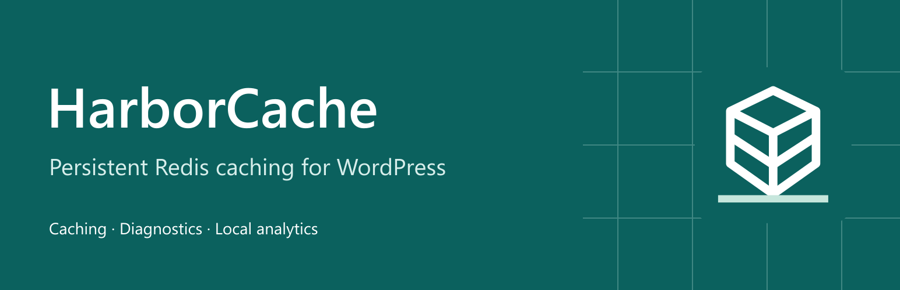
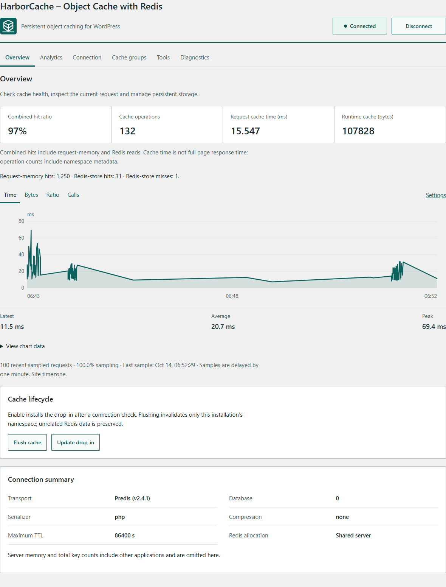
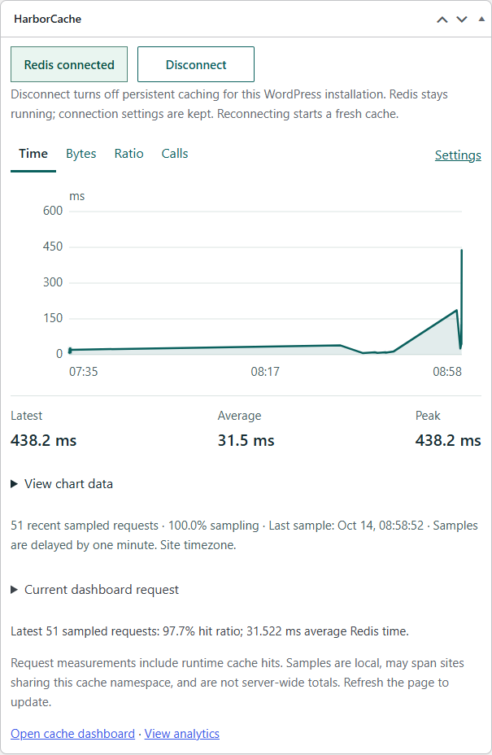

# HarborCache – Object Cache with Redis

Persistent Redis object caching for WordPress, with scoped invalidation, connection management, sampled analytics, diagnostics and a dashboard statistics widget. Current release build: **1.2.2**.

## Install

Install the [1.2.2 ZIP](dist/harborcache-1.2.2.zip) on an isolated staging site under Plugins → Add New → Upload Plugin. GitHub's source archive includes development documentation and media; use the installable ZIP for WordPress.

Requires WordPress 6.6+, PHP 7.4+ and a separately operated Redis service. Disable the existing object cache manager through its own controls first. Configure a distinct prefix in Settings → HarborCache, save the connection and enable the object cache. HarborCache refuses to overwrite another plugin's drop-in. Verify connection status and Site Health before using it on production.

For upgrades, back up configuration and the owned drop-in. Upload the plugin, then update the HarborCache drop-in if prompted. See [configuration](docs/CONFIGURATION.md), [1.2.2 release notes](docs/RELEASE-1.2.2.md) and [acceptance gates](docs/ACCEPTANCE.md).

## Features

- Predis, PhpRedis, Relay and Credis connection paths; standalone, replication, Sentinel and cluster configurations.
- Multisite cache group scopes, typed values, bulk operations and bounded TTLs.
- Namespace invalidation without FLUSHDB or FLUSHALL; bounded background reclamation.
- Optional serialization/compression, split autoloaded options and registered-key prefetching.
- Readable administration screens, equal-sized connection controls, responsive charts and accessible chart tables.
- Local sampled request analytics, separate runtime/store counters, WP-CLI, Site Health, Query Monitor and Debug Bar support.
- Protected configuration forms, redacted diagnostic exports, verified drop-in updates and recovery backups.

No license key or account is required. No plugin REST endpoints are included. Optional New Relic/OpenTelemetry adapters require explicit configuration and the host application's integration. See the [feature ledger](docs/FEATURES.md) for supported behavior and validation boundaries.

## Current screenshots

[All screenshots, logos, banners and favicons](media/) include version-free dashboard captures that remain reusable while the layout stays the same. They show a local test installation and demonstration chart history, not production speed measurements. Capture details are in [screenshots.json](media/screenshots.json).

## Validation and deployment gates

The 1.2.2 release includes the 1.2.1 review fixes and separates HarborCache-owned runtime constants from Redis Cache's compatibility settings. Its local tests, WordPress checks and package evidence are recorded in [1.2.2 validation](docs/VALIDATION-1.2.2.md). The 1.2.0 performance results remain documented in [the comparison](docs/COMPARISON-1.2.0.md); they do not predict performance on every server or guarantee WordPress.org approval.

Sustained production load, native Relay topology/failover and production tracing agents remain acceptance gates. HarborCache does not claim complete Object Cache Pro parity, WordPress.org approval or universal performance leadership. See [acceptance gates](docs/ACCEPTANCE.md).

## License and attribution

HarborCache is a GPL-3.0-only fork of Redis Object Cache 3.0.0 by Till Krüss and contributors, with original additions by Shahid Irfan. Original notices and bundled dependency licenses are preserved. See [LICENSE.md](LICENSE.md). Proprietary Object Cache Pro source and vendor services are not included. Original media has its separate GPL-2.0-or-later license described in media/README.md. Redis is a trademark of Redis Ltd.; no affiliation or endorsement is implied.
